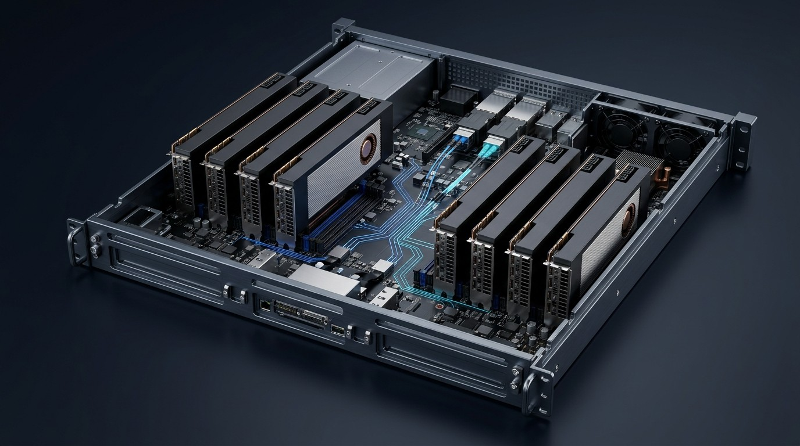
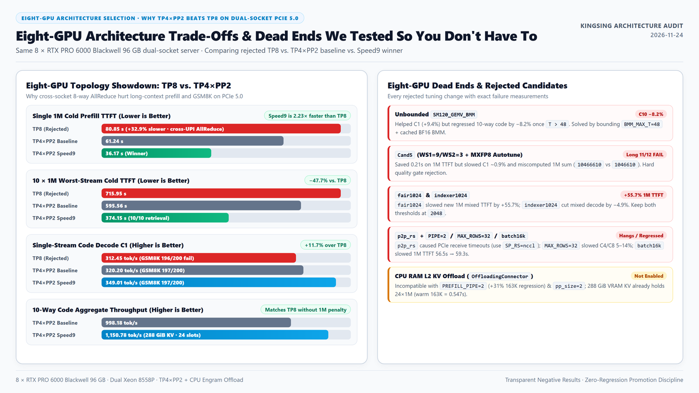
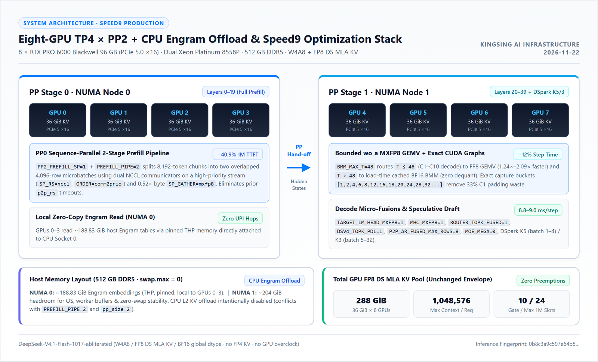
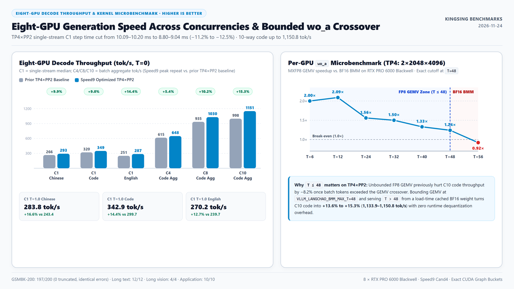
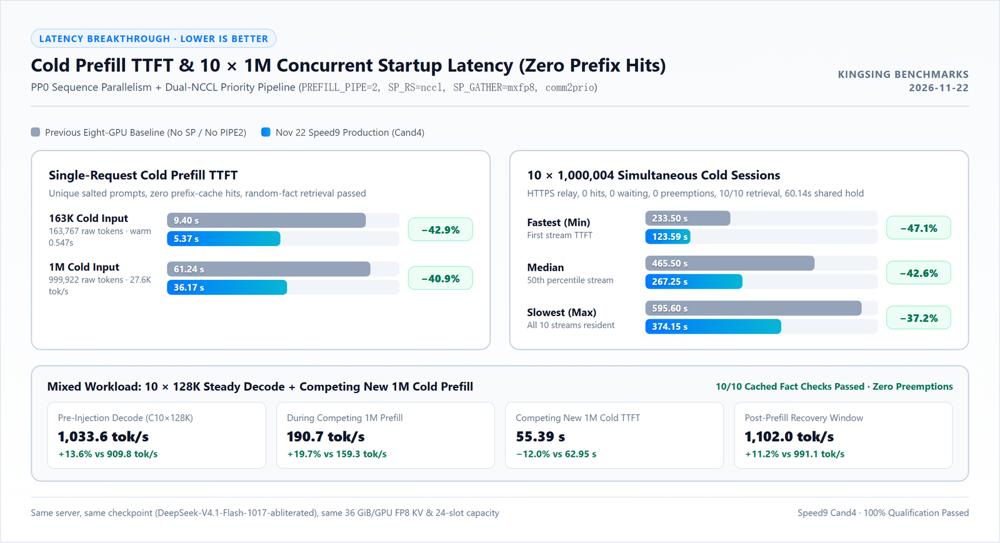

# DeepSeek-V4.1-Flash-1017 on Eight RTX PRO 6000 Blackwell 96 GB GPUs — Complete Production Guide

[Original Publication: KINGSING Company News](https://www.kingsing.com/news/KINGSING_DeepSeek_V41_Eight_GPU_RTX_PRO_6000_Deployment.html) · [Full English Engineering Guide](docs/eight-gpu-deployment-en.md) · [中文完整实战指南](docs/eight-gpu-deployment-zh.md)



> **Built for teams deploying `DeepSeek-V4.1-Flash-1017` on 8 × RTX PRO 6000 Blackwell 96 GB (768 GB total VRAM) dual-socket PCIe 5.0 servers.** This repository explains why **`TP4×PP2` + dual-NUMA CPU Engram offload** decisively beat `TP8` on long-context prefill and quality, breaks down the four lossless **Speed9** optimizations that achieved **36.17 s** 1M cold prefill, **349 tok/s** single-stream code, **1,150.8 tok/s** 10-way aggregate, and **10×1M to 24×1M** concurrent capacity—and publishes all **9 rejected eight-GPU dead ends** so you avoid repeating them.

---

## Quick Navigation / 快速导航

- [Performance Snapshot](#-performance-snapshot--核心成果一览)
- [Architecture Showdown: Why `TP4×PP2` Beats `TP8`](#-why-tp4pp2-beats-tp8-on-dual-socket-pcie-50--八卡架构决战)
- [The Four Lossless Speed9 Optimizations](#-four-lossless-speed9-optimizations--四大核心无损优化)
- [Ready-to-Adapt Launch Configuration](#-sanitized-launch-reference--核心脱敏启动参数)
- [10×1M / 24×1M Capacity & Mixed Workloads](#-cold-prefill-101m--241m-capacity--百万并发与混合负载)
- [9 Eight-GPU Dead Ends to Skip (Tested & Rejected)](#-9-eight-gpu-dead-ends-to-skip--八卡避坑红黑榜)
- [Repository Files & Offline Verification](#-repository-layout--offline-verification)

---

## Performance Snapshot / 核心成果一览

All metrics measured on **8 × NVIDIA RTX PRO 6000 Blackwell Server Edition 96 GB** (all PCIe 5.0 ×16), dual Intel Xeon Platinum 8558P CPUs, **512 GB DDR5**, **~188.83 GiB CPU Engram offload**, **W4A8 MoE (`b12x`)**, **FP8 DS MLA KV (`36 GiB/GPU`, `288 GiB` total, `24` scheduler slots)**, **DSpark dynamic `K=5/3`**, and a full **1,048,576-token** context window:

| Metric / Workload | Prior TP4×PP2 Baseline | Speed9 Optimized Production | Change / Notes |
|---|---:|---:|---|
| **163K cold prefill TTFT (`0` prefix hits)** | 9.40 s | **5.37 s** (GPU-warm: `0.547 s`) | **−42.9% (1.75×)** |
| **1M cold prefill TTFT (`0` prefix hits)** | 61.24 s | **36.17 s** (`36.23 / 36.17 s`) | **−40.9% (1.69×)** · `2.23×` faster than `TP8` |
| **Single-stream decode (`T=0`, Ch / Code / En)** | 266.3 / 320.2 / 251.1 | **292.6 / 349.0 / 287.2 tok/s** | **+8.3% to +14.4%** (`8.80–9.04 ms/step`) |
| **Single-stream decode (`T=1.0`, prod default)** | 243.4 / 299.7 / 239.7 | **283.8 / 342.9 / 270.2 tok/s** | **+12.7% to +16.6%** |
| **8-way aggregate decode (`T=0`, Ch / Code / En)** | 835.9 / 934.7 / 789.1 | **919.3 / 1,030.0 / 901.3 tok/s** | **+10.0% to +14.2%** |
| **10-way aggregate code / English (`T=0`)** | 998.2 / 862.5 | **1,133.9–1,150.8 / 964.8–976.1 tok/s** | **+11.9% to +15.3%** |
| **`10 × 1M` cold TTFT (min / med / max)** | 233.5 / 465.5 / 595.6 s | **123.59 / 267.25 / 374.15 s** | **−37.2% to −47.1%** · `571.0 tok/s` agg · `10/10` retrieval |
| **`24 × 1M` full-envelope capacity proof** | — | **755.09 tok/s** (`26.7–35.6`/stream) | `60.18 s` simultaneous hold · `24/24` retrieval · `0` preemptions |
| **Mixed `C10×128K + 1M` competing window** | 159.33 tok/s | **190.71 tok/s** (new 1M TTFT `55.39 s`) | **+19.7%** decode during prefill · `1,102.0 tok/s` recovery |
| **Quality & multimodal gates** | GSM8K 197/200 | **GSM8K 197/200 · Long 12/12 · Vision 6/6** | Identical errors · `T=1` `83/90` · App `10/10` · HTTPS `10/10` |

---

## Why `TP4×PP2` Beats `TP8` on Dual-Socket PCIe 5.0 / 八卡架构决战



When teams receive an 8-GPU server, the natural instinct is to set `--tensor-parallel-size 8`. On a dual-socket PCIe 5.0 system without NVSwitch, **our controlled same-machine A/B proved `TP8` is a trap for long-context workloads**:

- **Cross-socket UPI AllReduce penalty**: `TP8` forced every layer's tensor-parallel collective across CPU sockets over UPI—slowing single **1M cold prefill by `+32.9%` (`80.85 s` vs. `60.84 s`)**, slowing **10×1M worst-stream TTFT by `+20.2%` (`715.95 s` vs. `595.56 s`)**, and dipping single-stream code/English decode (`−1.1% / −4.9%`).
- **Quality gate failure**: Under the fixed `1,024`-token GSM8K gate, `TP8` dropped to `196/200` (1 truncation) while `TP4×PP2` passed `197/200` with zero truncations.
- **Why `TP4×PP2` (20/20 layer split) wins**: GPUs 0–3 (`NUMA 0`) execute PP Stage 0 (layers `0–19`) with local zero-copy reads into ~188.83 GiB pinned THP Engram tables; GPUs 4–7 (`NUMA 1`) execute PP Stage 1 (layers `20–39` + DSpark `K=5/3`). All `TP=4` collectives stay strictly inside their local PCIe 5.0 root complex, cross-socket traffic is reduced to lightweight stage activations, and each GPU retains **`36 GiB` FP8 KV (`288 GiB` total = `24` simultaneous 1M slots)**. After Speed9 tuning, `TP4×PP2` beats `TP8` by **`2.23×`** on 1M cold prefill (`36.17 s` vs. `80.85 s`) while delivering `1,150.8 tok/s` 10-way code aggregate.



---

## Four Lossless Speed9 Optimizations / 四大核心无损优化

1. **Bounded `wo_a` MXFP8 GEMV (`VLLM_LANGCHAO_BMM_MAX_T=48`) + Load-Time Cached BF16 BMM**: Per-GPU microbenchmarks proved FP8 GEMV beats BF16 BMM by `1.24×–2.09×` up to `T=48` and crosses over at `T=56` (`0.92×`). Bounding GEMV at `T ≤ 48` and serving `T > 48` from a load-time cached BF16 weight captures the entire C1–C8 speedup while reversing the `−8.2%` C10 regression seen with unbounded GEMV (`1,133.9–1,150.8 tok/s` on C10 code).
2. **Exact Decode CUDA Graph Buckets (`[1,2,4,6,8,12,16,18,20,24,28,32,36,40,44,48...128]`)**: Eliminates 33% wasted compute from default 8-step padding at C1 (`6→8`), C2 (`12→16`), C3 (`18→24`), C5 (`20→24`), and C7 (`28→32`), with `VLLM_LANGCHAO_GRAPH_AUDIT=0`.
3. **PP0 Sequence-Parallel Dual-NCCL Prefill Pipeline (`−40.9%` 1M TTFT)**: Because PP Stage 0 runs in its own OS process with only layers `0–19`, enabling `VLLM_LANGCHAO_PP2_PREFILL_SP=1`, `VLLM_MOET_PREFILL_PIPE=2`, `SP_RS=nccl`, `SP_GATHER=mxfp8` (0.52× all-gather bytes), and `ORDER=comm2prio` cleanly overlaps two 4,096-row microbatches on dual high-priority NCCL communicators—slashing 1M cold TTFT from `61.24 s → 36.17 s` without `p2p_rs` timeouts.
4. **Decode Micro-Fusions & Host Safeguards**: `TARGET_LM_HEAD_MXFP8=1`, `MHC_MXFP8=1`, `CANDIDATE_DET_TOPK=1`, `ROUTER_TOPK_FUSED=1`, `DSV4_TOPK_PDL=1`, `P2P_AG=1` (keeping `P2P_AR_FUSED_MAX_ROWS=8` and `MOE_MEGA=0`) drop C1 step latency from `10.09–10.20 ms` to **`8.80–9.04 ms` (`−11.2%` to `−12.5%`)**. Paired with GRUB `iommu=pt`, NUMA binding `[0,0,0,0,1,1,1,1]`, and explicit systemd scope `MemorySwapMax=0`.



---

## Sanitized Launch Reference / 核心脱敏启动参数

> Full parameter snapshot: [configs/2026-11-22-eight-gpu-speed9.json](configs/2026-11-22-eight-gpu-speed9.json)

```bash
# Key environment flags (8-GPU TP4xPP2, dual-NUMA [0,0,0,0,1,1,1,1])
VLLM_PP_LAYER_PARTITION=20,20
VLLM_B12X_MOE_FP4_FORCE_A16=0
VLLM_ALLREDUCE_USE_FLASHINFER_PCIE_IPC=1
VLLM_USE_BREAKABLE_CUDAGRAPH=1
VLLM_MOET_SM120_GEMV=1
VLLM_MOET_SM120_GEMV_BMM=1
VLLM_LANGCHAO_BMM_MAX_T=48
VLLM_MOET_MOE_MEGA=0
VLLM_MOET_B12X_MOE_FUSED=1
VLLM_MOET_B12X_MOE_PREFILL_FAST=1
VLLM_MOET_TARGET_LM_HEAD_MXFP8=1
VLLM_MOET_DRAFTER_LM_HEAD_MXFP8=0
VLLM_MOET_MHC_MXFP8=1
VLLM_MOET_CANDIDATE_DET_TOPK=1
VLLM_MOET_ROUTER_TOPK_FUSED=1
VLLM_MOET_DSV4_TOPK_PDL=1
VLLM_MOET_P2P_AR=1
VLLM_MOET_P2P_AG=1
VLLM_MOET_P2P_AR_FUSED_MAX_ROWS=8
VLLM_MOET_PREFILL_SP=1
VLLM_LANGCHAO_PP2_PREFILL_SP=1
VLLM_MOET_PREFILL_SP_RS=nccl
VLLM_MOET_PREFILL_SP_GATHER=mxfp8
VLLM_MOET_PREFILL_PIPE=2
VLLM_MOET_PREFILL_PIPE_ORDER=comm2prio
VLLM_LANGCHAO_PP2_DSPARK_LOCAL_AUX=1
VLLM_LANGCHAO_GRAPH_AUDIT=0

# Core vLLM serve arguments (swap.max=0 enforced at systemd scope)
python3 -m vllm.entrypoints.openai.api_server \
  --model /model --dtype bfloat16 \
  --tensor-parallel-size 4 --pipeline-parallel-size 2 \
  --disable-custom-all-reduce \
  --max-model-len 1048576 --max-num-seqs 24 --max-num-batched-tokens 8192 \
  --kv-cache-memory-bytes 38654705664 --kv-cache-dtype fp8_ds_mla --block-size 128 \
  --engram-config '{"cpu_offload": true, "use_thp": true}' \
  --numa-bind --numa-bind-nodes 0 0 0 0 1 1 1 1 \
  --attention-backend FLASHINFER_MLA_SPARSE_DSV41 \
  --linear-backend flashinfer_cutlass --moe-backend b12x \
  --attention-config '{"indexer_kv_dtype": "fp8", "indexer_tp_shard_min_rows": 2048}' \
  --long-prefill-token-threshold 2048 --long-prefill-token-threshold-adaptive \
  --compilation-config '{"cudagraph_mode":"FULL_DECODE_ONLY","compile_sizes":[],"cudagraph_capture_sizes":[1,2,4,6,8,12,16,18,20,24,28,32,36,40,44,48,52,56,60,64,72,80,88,96,104,112,120,128],"max_cudagraph_capture_size":128,"cudagraph_decoder_replay":false}' \
  --speculative-config '{"method":"dspark","num_speculative_tokens":5,"draft_sample_method":"probabilistic","rejection_sample_method":"standard","enable_adaptive_verification":false,"num_speculative_tokens_per_batch_size":[[1,4,5],[5,32,3]]}'
```

---

## Cold Prefill, 10×1M & 24×1M Capacity / 百万并发与混合负载



- **`10 × 1,000,004` Cold Concurrent Gate (`60.14 s` shared hold)**: Cold TTFT cut **−37.2% to −47.1%** (`123.59 / 267.25 / 374.15 s`), steady aggregate **`571.02 tok/s`** (`53.29–64.12`/stream), `10/10` retrieval, `0` waiting, `0` preemptions.
- **`24 × 1,000,004` Full-Envelope Proof (`60.18 s` shared hold)**: Under the identical `36 GiB/GPU` (`288 GiB` total) KV envelope, all 24 independent cold million-token sessions resided simultaneously at **`755.09 tok/s`** aggregate (`26.66–35.60`/stream), `24/24` retrieval, `0` preemptions (cold TTFT median `831.47 s`, max `1,439.22 s`).
- **Mixed `C10×128K + 1M` Cold Injection**: Baseline `1,033.56 tok/s` (`+13.6%`) → competing prefill `190.71 tok/s` (`+19.7%`), new 1M TTFT `55.39 s` (`−12.0%`) → recovery `1,102.00 tok/s` (`+11.2%`), `10/10` cached checks passed.

---

## 9 Eight-GPU Dead Ends to Skip / 八卡避坑红黑榜

| Tested Setting / Architecture | Measured Failure or Regression | Recommendation |
|---|---|---|
| **`TP8` across dual PCIe sockets** | 1M cold TTFT `+32.9%` slower (`80.85s`), 10×1M max `+20.2%` (`715.95s`), GSM8K `196/200` fail | **Use `TP4×PP2` (20/20)** |
| **Unbounded `SM120_GEMV_BMM`** | C1 rose `+9.4%`, but C10 code regressed **`−8.2%`** above `T=48` | **Bound `BMM_MAX_T=48`** + cached BF16 BMM |
| **`Cand5` (`WS1=9/WS2=3` + MXFP8 Autotune)** | Saved only `0.21 s` on 1M, slowed C1 `~0.9%`, **failed `long_quality` `id=5`** (`10466610` vs `1046610`) | **Rejected under zero-regression gate** |
| **CPU RAM L2 KV (`OffloadingConnector`)** | Blocked by `PREFILL_PIPE=2` (`+31%` 163K regression) & `pp_size=2`; `288 GiB` VRAM already fits `24×1M` | **Do not enable on `TP4×PP2`** |
| **Early `p2p_rs` with `PREFILL_PIPE=2`** | Triggered PCIe P2P receive timeouts / hangs under concurrent load | **Use `SP_RS=nccl` + `ORDER=comm2prio`** |
| **`P2P_AR_FUSED_MAX_ROWS=32`** | One-shot PCIe push congested above `M=8`, regressing C4/C8 by `5–14%` | **Keep `8`** |
| **`VLLM_MOET_MOE_MEGA=1`** | Per-GPU microbench measured `162.85 µs` vs. `160.95 µs` separate (`+1.9 µs/layer` slower) | **Keep `0`** |
| **`--max-num-batched-tokens 16384`** | Regressed 1M cold prefill TTFT from `56.48 s` to `59.34 s` | **Keep `8192`** |
| **`fair1024` / `indexer1024`** | `fair1024` slowed new 1M mixed TTFT by **`+55.7%`**; `indexer1024` cut mixed decode by **`−4.9%`** | **Keep both at `2048`** |

---

## Repository Layout & Offline Verification

| Path | Description |
|---|---|
| [docs/eight-gpu-deployment-en.md](docs/eight-gpu-deployment-en.md) | Complete English 8-GPU architecture, Speed9 & dead-end engineering guide |
| [docs/eight-gpu-deployment-zh.md](docs/eight-gpu-deployment-zh.md) | 中文八卡 `TP4×PP2` 架构选型、Speed9 优化与全套避坑实战手册 |
| [configs/2026-11-22-eight-gpu-speed9.json](configs/2026-11-22-eight-gpu-speed9.json) | Sanitized Speed9 CLI arguments, environment flags & build boundaries |
| [data/2026-11-22-eight-gpu-speed9.json](data/2026-11-22-eight-gpu-speed9.json) | Complete sanitized Speed9, 10×1M, 24×1M, mixed-load & quality JSON |
| [tools/verify_8gpu_benchmarks.py](tools/verify_8gpu_benchmarks.py) | Offline data consistency checker, sanitization scanner & strict 8-GPU isolation validator |
| [assets/](assets/) | 5 high-resolution 8-GPU diagrams and benchmark visuals |

```bash
python tools/verify_8gpu_benchmarks.py
```

### Scope, Attribution & Licensing
- **Evaluated checkpoint**: [`deepseek-ai/DeepSeek-V4.1-Flash-1017`](https://huggingface.co/deepseek-ai/DeepSeek-V4.1-Flash-1017) (official release). Official original weights; refusal rates were not evaluated.
- **Upstream references**: [DeepSeek-V4.1-Flash-1017](https://huggingface.co/deepseek-ai/DeepSeek-V4.1-Flash-1017) · [vLLM-Moet](https://github.com/kacper-daftcode/vLLM-Moet) · [GSM8K](https://github.com/openai/grade-school-math/tree/3101c7d5072418e28b9008a6636bde82a006892c).
- **Exclusions**: No model weights, serving images, private addresses, credentials, host paths, or full datasets are distributed. Documentation copyright KINGSING; third-party software and models remain governed by their upstream licenses.
