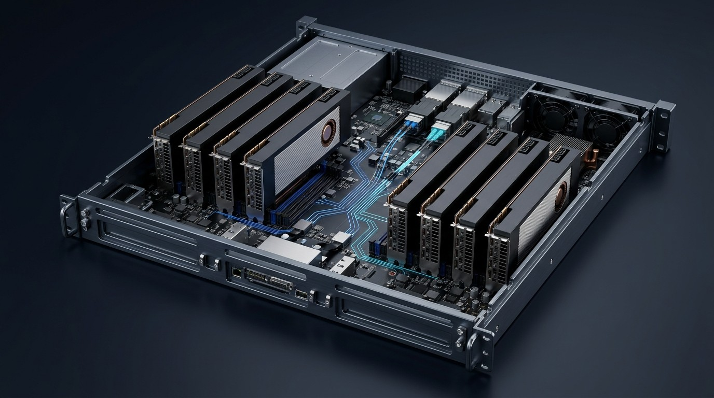
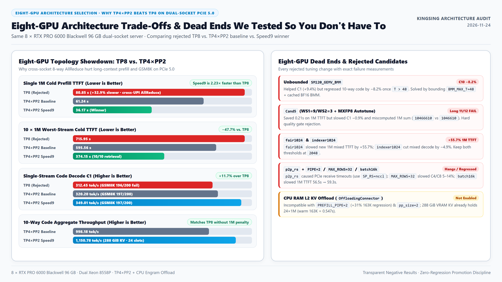
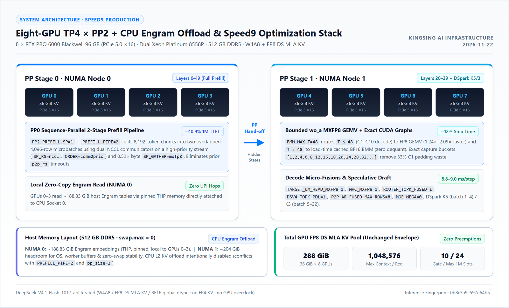
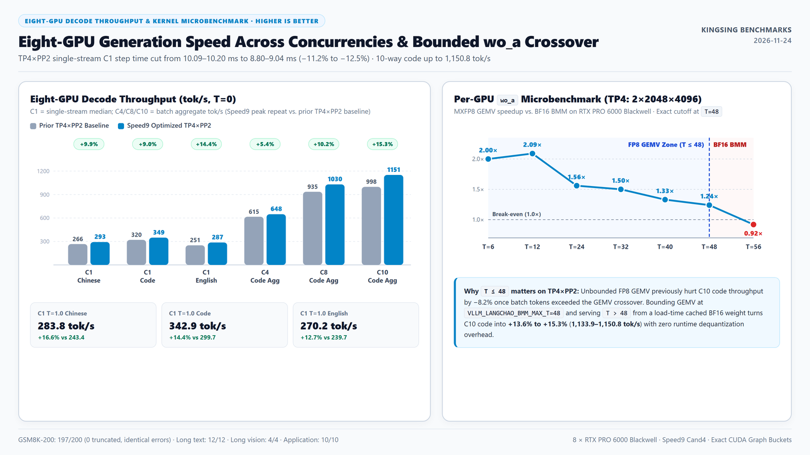
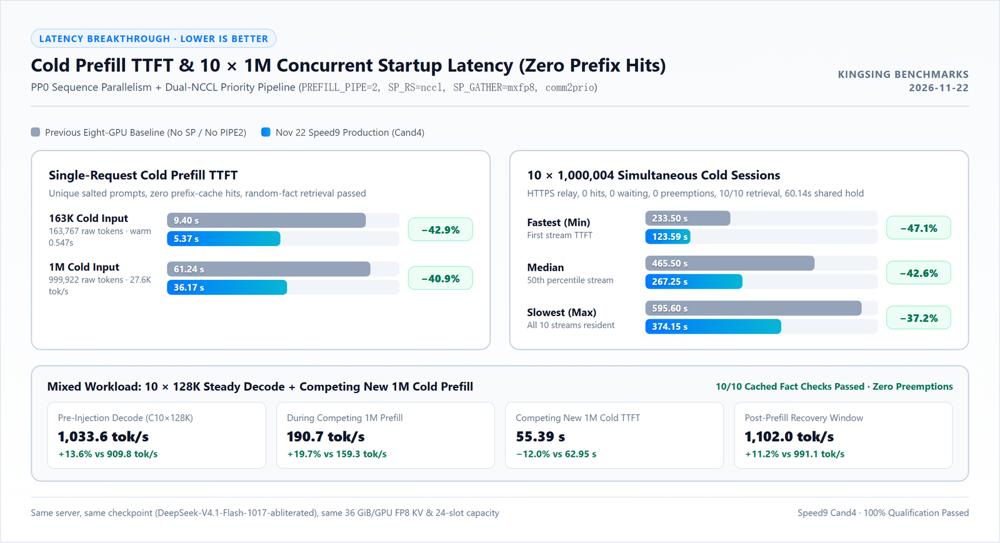

# Eight-GPU DeepSeek-V4.1-Flash-1017 Engineering Guide: Why TP4×PP2 Beats TP8, 36-Second 1M Prefill, 1,151 tok/s 10-Way Output and 24×1M Capacity on 8× RTX PRO 6000 Blackwell

[Original publication: KINGSING Company News](https://www.kingsing.com/news/KINGSING_DeepSeek_V41_Eight_GPU_RTX_PRO_6000_Deployment.html) · [中文完整实战指南](eight-gpu-deployment-zh.md)

When deploying `DeepSeek-V4.1-Flash-1017` on a dual-socket **8 × NVIDIA RTX PRO 6000 Blackwell Server Edition 96 GB (`768 GB` VRAM)** PCIe 5.0 server, the single most expensive mistake teams make is blindly launching `TP=8` or copying unverified environment flags.

This guide documents KINGSING's complete eight-GPU engineering journey: why we tested and rejected `TP8`, how locking to symmetrical dual-NUMA **`TP4×PP2` (20/20 layers) + CPU Engram offload** preserved **288 GiB of FP8 KV (`24` simultaneous 1M slots)**, how our four lossless **Speed9** kernel and pipeline optimizations delivered **36.17 s** 1M cold prefill (`−40.9%`), **349.0 tok/s** single-stream code, and **1,150.8 tok/s** 10-way aggregate—and all **9 eight-GPU dead ends** we measured and rejected so fellow operators can skip straight to production.

> **Evaluation Disclosure:** All measurements evaluate `deepseek-ai/DeepSeek-V4.1-Flash-1017` (official release) under strict precision guardrails (`W4A8` experts, `fp8_ds_mla` KV at `36 GiB/GPU`, `BF16` global dtype, DSpark `K=5/3`, zero FP4 KV, zero GPU overclocking). Official original weights; refusal rates were not evaluated.

---

## 1. Architecture Showdown: Why `TP4×PP2` Decisively Beats `TP8` on Dual-Socket PCIe 5.0

The host combines **8 × RTX PRO 6000 Blackwell 96 GB** (all PCIe 5.0 ×16 under load), dual **Intel Xeon Platinum 8558P** CPUs, and **512 GB DDR5** (`499 GiB` visible), with GRUB `iommu=pt` unlocking PCIe peer-to-peer transfers and `MemorySwapMax=0` enforced on the serving cgroup.

Before optimizing kernels, we ran a controlled same-machine architecture showdown between **`TP8`** (`32 GiB/GPU` KV) and **`TP4×PP2`** (`36 GiB/GPU` KV, `20/20` layers):

| Metric (Same 8-GPU Server & Checkpoint) | Rejected `TP8` (`32 GiB/GPU` KV) | Prior `TP4×PP2` Baseline | Final `TP4×PP2` Speed9 Winner | Engineering Verdict |
|---|---:|---:|---:|---|
| **Single 1M cold prefill TTFT (`0` hits)** | **80.85 s** (`+32.9%` slower) | 61.24 s | **36.17 s** | **Speed9 is `2.23×` faster than `TP8`** |
| **`10 × 1M` worst-stream cold TTFT** | **715.95 s** (`+20.2%` slower) | 595.56 s | **374.15 s** | **−47.7% vs. `TP8`**; cross-UPI AllReduce kills `TP8` prefill |
| **Single-stream code / English (`T=0`)** | 312.5 / 236.1 tok/s | 320.2 / 251.1 tok/s | **349.0 / 287.2 tok/s** | Speed9 beats `TP8` by **`+11.7% / +21.6%`** |
| **8-way / 10-way code aggregate (`T=0`)** | 1,068.4 / 1,212.3 tok/s | 934.7 / 998.2 tok/s | **1,030.0 / 1,150.8 tok/s** | Within ~5% on short bursts without any 1M penalty |
| **GSM8K fixed `1,024`-budget gate** | **196 / 200 (FAIL, 1 trunc)** | 197 / 200 (PASS) | **197 / 200 (PASS)** | `TP8` missed the fixed 1,024-token gate |
| **GPU FP8 KV pool & max 1M slots** | 256 GiB (`32 GiB/GPU`) | 288 GiB (`36 GiB/GPU`, 24 slots) | **288 GiB (`36 GiB/GPU`, 24 slots)** | Full `24×1M` VRAM headroom preserved |

**Why `TP4×PP2` fits dual-socket PCIe 5.0 physics:** Every `TP=4` rank group stays 100% inside a single CPU socket's PCIe 5.0 root complex—GPUs 0–3 on `NUMA 0` run layers `0–19` with zero-copy local access to ~188.83 GiB pinned THP Engram tables, while GPUs 4–7 on `NUMA 1` run layers `20–39` plus DSpark `K=5/3`. Only compact hidden states cross the inter-socket UPI link once per pipeline stage.

---

## 2. Deep Dive: The Four Lossless Speed9 Optimizations

Once `TP4×PP2` was locked, four surgical optimizations pushed every regime—single-stream latency, 10-way throughput, and million-token cold prefill—dramatically forward with zero precision loss:

1. **Bounded `wo_a` MXFP8 GEMV (`VLLM_LANGCHAO_BMM_MAX_T=48`) + Load-Time Cached BF16 BMM**:
   - Earlier testing of unbounded `SM120_GEMV_BMM` gained `+9.4%` at C1 but **regressed 10-way code by `−8.2%`**.
   - Per-GPU microbenchmarks (`groups=2, N=2048, K=4096`) revealed the exact hardware crossover: FP8 GEMV wins **`2.00×` at `T=6`**, **`2.09×` at `T=12`**, **`1.56×` at `T=24`**, **`1.50×` at `T=32`**, **`1.33×` at `T=40`**, and **`1.24×` at `T=48`**, then loses at **`T=56` (`0.92×`)**.
   - Bounding GEMV at `VLLM_LANGCHAO_BMM_MAX_T=48` and serving `T > 48` from a load-time cached BF16 weight (`_langchao_bmm_bf16`, zero runtime dequantization) turned C10 code from `−8.2%` into **`+13.6% to +15.3%` (`1,133.9–1,150.8 tok/s`)**.
2. **Exact Decode CUDA Graph Capture Buckets (`[1,2,4,6,8,12,16,18,20,24...128]`)**:
   - Default 8-step graph buckets padded C1 (`6` tokens with `K=5`) up to `8` (`+33%` wasted compute), C2 (`12→16`), C3 (`18→24`), C5 (`20→24`), and C7 (`28→32`). Exact buckets + `VLLM_LANGCHAO_GRAPH_AUDIT=0` eliminated padding waste across everyday concurrency.
3. **PP0 Dual-NCCL Sequence-Parallel Prefill Pipeline (`−40.9%` 1M TTFT)**:
   - Because PP Stage 0 runs in its own dedicated worker process holding only layers `0–19` (independent Python GIL), enabling `VLLM_LANGCHAO_PP2_PREFILL_SP=1`, `VLLM_MOET_PREFILL_PIPE=2`, `SP_RS=nccl`, `SP_GATHER=mxfp8` (0.52× PCIe bytes), and `ORDER=comm2prio` overlaps two 4,096-row microbatches on dual high-priority NCCL communicators.
   - This cut 163K cold TTFT from `9.40 s → 5.37 s` (`−42.9%`) and 1M cold TTFT from `61.24 s → 36.17 s` (`−40.9%`), completely eliminating the `p2p_rs` receive timeouts observed in earlier unguarded runs.
4. **Decode Micro-Fusions & Systemd Swap Guardrails**:
   - Enabling `TARGET_LM_HEAD_MXFP8=1`, `MHC_MXFP8=1`, `CANDIDATE_DET_TOPK=1`, `ROUTER_TOPK_FUSED=1`, `DSV4_TOPK_PDL=1`, `P2P_AG=1` (while locking `P2P_AR_FUSED_MAX_ROWS=8` and `MOE_MEGA=0`) dropped single-stream step latency from `10.09–10.20 ms` to **`8.80–9.04 ms` (`−11.2%` to `−12.5%`)**.
   - On the host side, explicitly writing and verifying `MemorySwapMax=0` on the Docker systemd scope prevented silent swap regressions after `systemd daemon-reload`.

---

## 3. Same-Day Paired Generation Speed (Baseline vs. Speed9)

Both profiles ran on the exact same server, checkpoint, and short-prompt suite (`temperature=0`, thinking disabled, `1,024`-token budget; C1 = single-stream median; C4/C8/C10 = batch aggregate):

| Concurrency | Task | Prior TP4×PP2 Baseline (tok/s) | Speed9 R1 (tok/s) | Speed9 R2 (tok/s) | Speed9 vs. Baseline |
|---|---|---:|---:|---:|---:|
| 1 | Chinese | 266.32 | 292.58 | 291.67 | **+9.5% to +9.9%** |
| 1 | Code | 320.20 | 349.01 | 346.64 | **+8.3% to +9.0%** |
| 1 | English | 251.09 | 280.68 | 287.17 | **+11.8% to +14.4%** |
| 4 | Chinese (agg) | 519.70 | 547.78 | 551.60 | **+5.4% to +6.1%** |
| 4 | Code (agg) | 615.31 | 642.45 | 648.36 | **+4.4% to +5.4%** |
| 4 | English (agg) | 483.17 | 519.02 | 525.59 | **+7.4% to +8.8%** |
| 8 | Chinese (agg) | 835.94 | 883.63 | 919.27 | **+5.7% to +10.0%** |
| 8 | Code (agg) | 934.69 | 963.33 | 1,029.95 | **+3.1% to +10.2%** |
| 8 | English (agg) | 789.06 | 870.34 | 901.34 | **+10.3% to +14.2%** |
| 10 | Chinese (agg) | 1,002.97 | 998.66 | 1,008.71 | −0.4% to +0.6% |
| 10 | Code (agg) | 998.18 | 1,150.78 | 1,133.89 | **+13.6% to +15.3%** |
| 10 | English (agg) | 862.51 | 964.75 | 976.13 | **+11.9% to +13.2%** |

Under production default sampling (`temperature=1.0, top_p=1.0`), single-stream decode reached **`283.80 / 342.88 / 270.15 tok/s`** for Chinese / code / English (**`+16.6% / +14.4% / +12.7%`** over the prior unoptimized `TP4×PP2` `T=1.0` reference), with short-task quality at `28/30`.

---

## 4. Cold Prefill, 10×1M / 24×1M Capacity & Mixed Workloads

| Workload | Prior Eight-GPU Baseline | Speed9 Optimized | Change |
|---|---:|---:|---|
| **Single 163K cold prefill TTFT (`0` hits)** | 9.40 s | **5.37 s** (GPU-warm: `0.547 s`) | **−42.9% (1.75×)** |
| **Single 1M cold prefill TTFT (`0` hits)** | 61.24 s | **36.17 s** (`36.23 / 36.17 s`) | **−40.9% (1.69×)** |
| **`10 × 1M` cold TTFT (min / med / max)** | 233.5 / 465.5 / 595.6 s | **123.59 / 267.25 / 374.15 s** | **−47.1% / −42.6% / −37.2%** |
| **`10 × 1M` shared 60s steady decode** | 572.48 tok/s | **571.02 tok/s** (`53.29–64.12`/stream) | Parity; `10/10` retrieval, `0` preemptions |
| **`24 × 1M` full-envelope 60s steady decode** | — | **755.09 tok/s** (`26.66–35.60`/stream) | `24/24` retrieval, `0` preemptions (TTFT med `831.5 s`, max `1,439.2 s`) |
| **Mixed `C10×128K + 1M`: baseline window** | 909.81 tok/s | **1,033.56 tok/s** | **+13.6%** |
| **Mixed `C10×128K + 1M`: during 1M prefill** | 159.33 tok/s | **190.71 tok/s** | **+19.7%** |
| **Mixed `C10×128K + 1M`: new 1M TTFT** | 62.95 s | **55.39 s** | **−12.0%** |
| **Mixed `C10×128K + 1M`: recovery window** | 991.06 tok/s | **1,102.00 tok/s** | **+11.2%** |

A separate single-request `1M` `60.67`-second hold test ran at **`388.80 tok/s`** steady decode. All `10×1M` and `24×1M` sessions carried `1,000,004` independent salted tokens each with zero prefix hits and zero preemptions.

---

## 5. Historical Eight-GPU Dead Ends & Rejected Optimizations

Every failed tuning attempt is preserved transparently so teams running 8 × RTX PRO 6000 Blackwell can avoid them completely:

1. **`TP8` across dual PCIe sockets**: Slowed 1M cold prefill by `+32.9%` (`80.85 s`), slowed `10×1M` worst-stream TTFT by `+20.2%` (`715.95 s`), and missed the `1,024`-budget GSM8K gate (`196/200`).
2. **Unbounded `VLLM_MOET_SM120_GEMV_BMM=1`**: Boosted C1 (`+9.4%`) but regressed C10 code by **`−8.2%`** once `T > 48`. Fixed by bounding `VLLM_LANGCHAO_BMM_MAX_T=48`.
3. **`Cand5` (`WS1=9/WS2=3` + FlashInfer MXFP8 autotune warmup)**: Trimmed 1M TTFT by only `0.21 s` (`35.94 s`), slowed C1 `~0.9%`, and **failed 1/12 `long_quality` checks** (`id=5` 1M non-thinking sum emitted `10466610` instead of `1046610`). Rejected cleanly.
4. **CPU RAM L2 KV Cache (`OffloadingConnector`)**: Three code-verified blockers on `TP4×PP2`—incompatible with `PREFILL_PIPE=2` (`+31%` 163K regression), `replicated_layout` restricted to `pp_size == 1`, and `288 GiB` GPU KV already holds `24×1M` (warm 163K TTFT `0.547 s`).
5. **Early `p2p_rs` with `PREFILL_PIPE=2`**: Triggered PCIe P2P receive timeouts. Fixed by switching to `SP_RS=nccl` + `ORDER=comm2prio`.
6. **`VLLM_MOET_P2P_AR_FUSED_MAX_ROWS=32`**: Congested PCIe above `M=8`, regressing C4/C8 by `5–14%`. Locked at `8`.
7. **`VLLM_MOET_MOE_MEGA=1`**: Microbench measured `162.85 µs` vs. `160.95 µs` separate (`+1.9 µs/layer` slower). Locked at `0`.
8. **`--max-num-batched-tokens 16384`**: Regressed 1M cold TTFT from `56.48 s → 59.34 s`. Locked at `8192`.
9. **`fair1024` and `indexer1024`**: `fair1024` slowed competing 1M TTFT by **`+55.7%`** for only `+2.2%` mixed decode; `indexer1024` cut mixed decode by **`−4.9%`**. Keep both thresholds at `2048`.

---

## 6. Full Quality, Protocol Qualification & Reproducibility Scope

| Evaluation Suite | Prior Baseline | Speed9 Production | Notes |
|---|---:|---:|---|
| **GSM8K fixed 200-question subset (`1,024` budget, chat)** | 197/200 | **197/200** | `0` truncated; identical 3 error indices `[52, 55, 150]` |
| **Authored short tasks (chat / low thinking)** | 28/30 / 30/30 | **28/30 / 30/30** | Batch `c=10`: `28/30` & `30/30` |
| **Production sampling quality (`T=1.0`, 90 tasks)** | Gate ≥82/90 | **83/90** | Above production gate |
| **Application & multimodal checks** | 10/10 / 2/2 / 4/4 | **App 10/10 · Short 2/2 · Long 4/4** | Includes 60s soak & multimodal long context |
| **Long text checks (`10×163K + 2×1M`, cold)** | 12/12 | **12/12** | Zero prefix hits |
| **Public HTTPS acceptance / cold cancel** | 10/10 / 3/3 | **10/10 / 3/3** | Chat / Messages (literal tokens) / Responses (tool call) all HTTP 200 |

- Built on `vLLM 0.32.1rc1.dev117+gdf3bd094a` and `PyTorch 2.14.0+cu130` with Moet kernels, bounded `wo_a` GEMV/BF16-BMM dispatch, and CLI protocol patches—not a full from-scratch vLLM/PyTorch rebuild. An operator-cancelled one-hour 24-client soak remains unexecuted.
- [Sanitized 8-GPU Speed9 benchmark & capacity dataset](../data/2026-11-22-eight-gpu-speed9.json) · [Sanitized 8-GPU configuration snapshot](../configs/2026-11-22-eight-gpu-speed9.json) · [Offline verifier](../tools/verify_8gpu_benchmarks.py).
