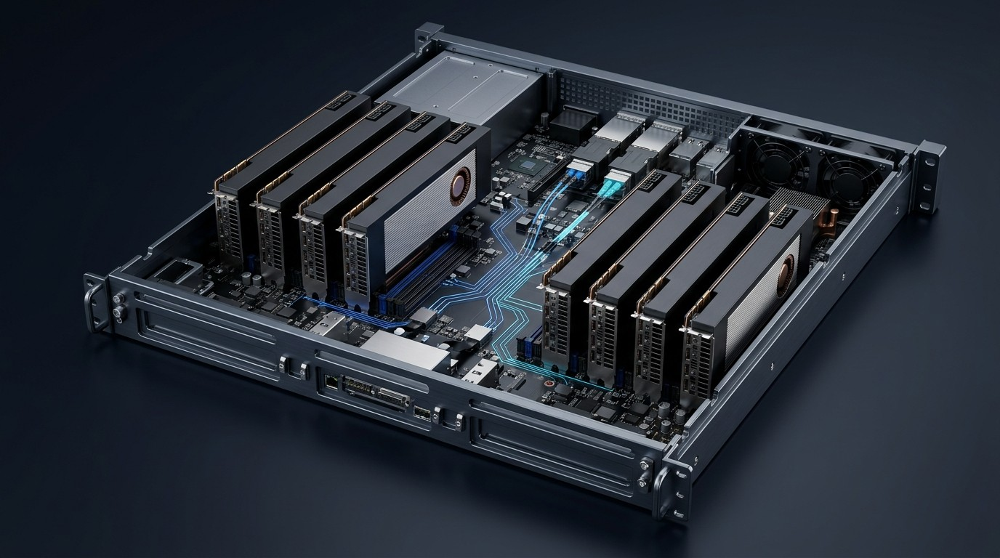
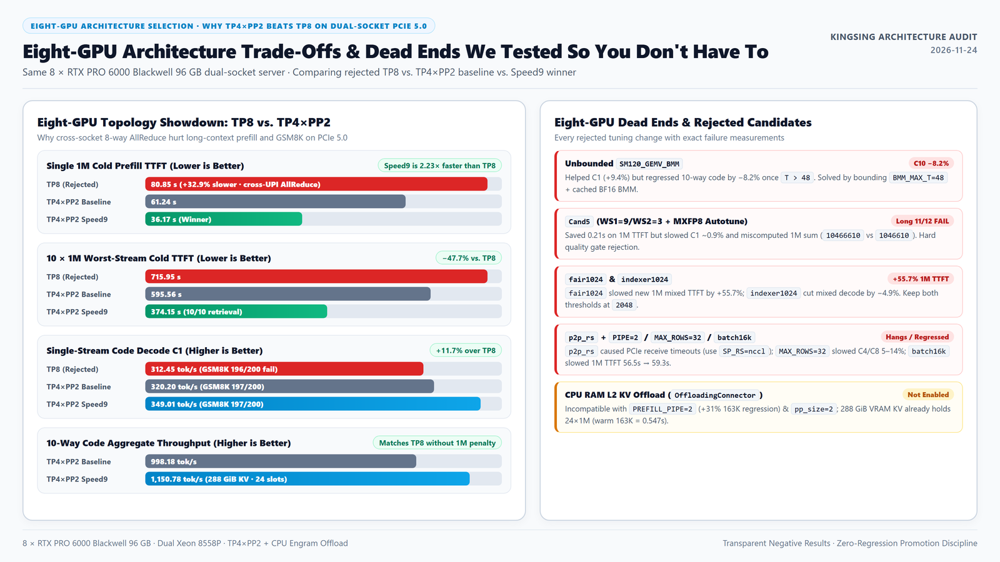
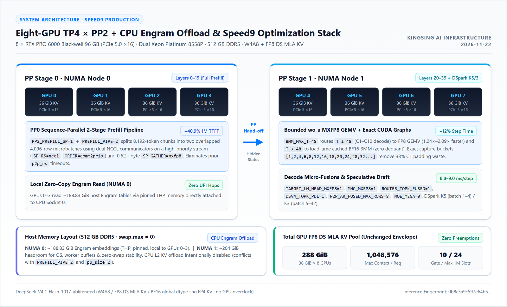
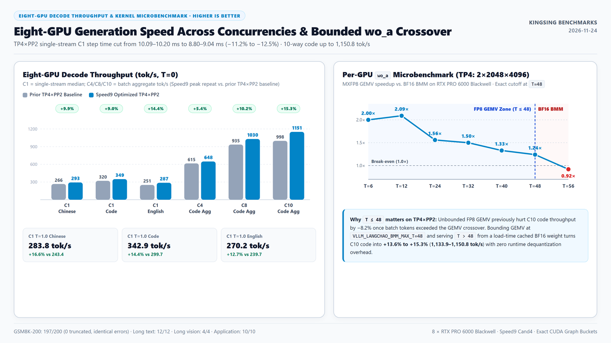
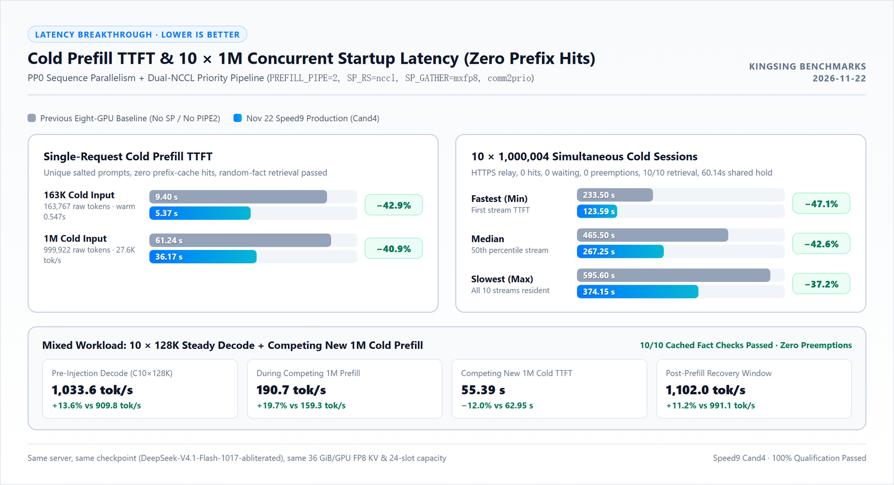

# 八卡 RTX PRO 6000 Blackwell 部署 DeepSeek-V4.1-Flash-1017 完整实战指南与避坑手册

[KINGSING 官网英文原文](https://www.kingsing.com/news/KINGSING_DeepSeek_V41_Eight_GPU_RTX_PRO_6000_Deployment.html) · [Full English Engineering Guide](eight-gpu-deployment-en.md)

拿到一台双路 **8 × NVIDIA RTX PRO 6000 Blackwell 96 GB（768 GB 总显存）** PCIe 5.0 服务器来部署 `DeepSeek-V4.1-Flash-1017`（1,048,576 上下文），几乎所有工程师的第一直觉都是直接上 `TP=8`——但我们在同机受控实测中发现，**在无 NVSwitch 的双路 PCIe 5.0 服务器上，`TP8` 反而是长上下文与质量门禁的双重陷阱**。

本文面向所有 8 卡 RTX PRO 6000 Blackwell 团队，完整分享我们为什么淘汰 `TP8` 并锁定对称双 NUMA **`TP4×PP2`（20/20 层）+ CPU Engram 卸载**、如何凭借 **Speed9 四大无损黑科技** 实现 **`36.17 s` 百万冷首字、`349 tok/s` 单流代码、`1,150.8 tok/s` 十路代码聚合与 `10×1M ~ 24×1M` 超高并发容量**，并如实公开我们实测淘汰的 **9 大八卡死胡同**，帮你直接跳过昂贵的重复试错。

> **评测声明**：全部数据基于 `deepseek-ai/DeepSeek-V4.1-Flash-1017`（official release），严格维持 `W4A8`、`fp8_ds_mla` KV（`36 GiB/卡`）、`BF16` 全局权重、DSpark 动态 `K=5/3`、零 FP4 KV、零超频；未评测拒答率。

---

## 1. 八卡架构决战：为什么必须选 `TP4×PP2` 而淘汰 `TP8`？

同机（8 × RTX PRO 6000 Blackwell 96 GB、双路 Xeon Platinum 8558P、512 GB DDR5、GRUB `iommu=pt`、`MemorySwapMax=0`）、同权重受控实测对比：

| 指标（同机 8 卡实测） | 淘汰方案 `TP8`（KV=32G/卡） | 原 `TP4×PP2` 基线 | 最终 `TP4×PP2` Speed9 | 架构结论 |
|---|---:|---:|---:|---|
| **单路 1M 冷首字（0 命中）** | **80.85 s**（慢 `+32.9%`） | 61.24 s | **36.17 s** | **Speed9 比 `TP8` 快 `2.23×`** |
| **`10×1M` 最慢流冷首字** | **715.95 s**（慢 `+20.2%`） | 595.56 s | **374.15 s** | **比 `TP8` 降 `-47.7%`**；跨 UPI 8 卡 AllReduce 拖垮长输入 |
| **单流代码 / 英文（T=0）** | 312.5 / 236.1 tok/s | 320.2 / 251.1 tok/s | **349.0 / 287.2 tok/s** | Speed9 领先 `TP8` **`+11.7% / +21.6%`** |
| **8 路 / 10 路代码聚合（T=0）** | 1,068.4 / 1,212.3 tok/s | 934.7 / 998.2 tok/s | **1,030.0 / 1,150.8 tok/s** | 短突发接近且无任何长文退化 |
| **GSM8K 固定 1024 预算门禁** | **196 / 200（未过，1 题截断）** | 197 / 200（过） | **197 / 200（过）** | `TP8` 未通过固定预算质量门禁 |
| **GPU FP8 KV 总容量与槽位** | 256 GiB（32G/卡） | 288 GiB（36G/卡，24 槽） | **288 GiB（36G/卡，24 槽）** | 完整保留 `24×1M` 显存余量 |

**底层物理原因**：在双路 PCIe 5.0 机器上，`TP4×PP2`（20/20 分区）将两组 `TP=4` 严格锁死在各自 CPU Socket 的本地 PCIe 5.0 域内——`GPU 0–3`（`NUMA 0`）运行 0–19 层并零跨路直读约 `188.83 GiB` 锁页 THP Engram 表；`GPU 4–7`（`NUMA 1`）运行 20–39 层与 DSpark `K=5/3`，跨 Socket 仅传递轻量流水线激活值。

---

## 2. Speed9 四大无损核心技术深度拆解

1. **分段有界 `wo_a` MXFP8 GEMV（`VLLM_LANGCHAO_BMM_MAX_T=48`）+ 加载期缓存 BF16 BMM**：
   - 早期全量无界开启 `SM120_GEMV_BMM` 虽然单流代码涨了 `+9.4%`，却把 10 路代码打跌了 **`-8.2%`**；
   - 单卡微基准实测证明 FP8 GEMV 在 `T=6..48` 领先 BF16 BMM **`1.24×–2.09×`**，在 `T=56` 处反被超越（`0.92×`）；
   - 将阈值精准截断在 `T ≤ 48`、`T > 48` 走加载期缓存的 BF16 权重（零运行时反量化），既拿满 C1–C8 加速，又把 C10 代码反转提升至 **`+13.6%~+15.3%`（`1,133.9–1,150.8 tok/s`）**。
2. **精确解码 CUDA Graph 捕获桶 `[1,2,4,6,8,12,16,18,20,24...128]`**：
   - 彻底消除默认 8 步进在 C1（6→8，浪费 33% 算力）、C2（12→16）、C3（18→24）上的 padding 空转，同时设 `VLLM_LANGCHAO_GRAPH_AUDIT=0`。
3. **PP0 序列并行 + 双高优先级 NCCL 预填充流水线（`-40.9%` 1M 冷首字）**：
   - 得益于 `PP=2` 下 Stage 0 为独立操作系统进程（独立 Python GIL 且仅持 20 层），开启 `VLLM_LANGCHAO_PP2_PREFILL_SP=1`、`VLLM_MOET_PREFILL_PIPE=2`、`SP_RS=nccl`、`SP_GATHER=mxfp8`（0.52× 通信量）与 `ORDER=comm2prio`，在双高优先级 NCCL 通信器上将 8,192 块拆为双 4,096 微批重叠执行，把 `163K / 1M` 冷首字压至 **`5.37 s / 36.17 s`**，彻底杜绝早期 `p2p_rs` 超时挂死。
4. **小行解码微融合 + `MemorySwapMax=0` 稳定性加固**：
   - 开启 `TARGET_LM_HEAD_MXFP8=1`、`MHC_MXFP8=1`、`CANDIDATE_DET_TOPK=1`、`ROUTER_TOPK_FUSED=1`、`DSV4_TOPK_PDL=1`、`P2P_AG=1`（锁死 `P2P_AR_FUSED_MAX_ROWS=8`、`MOE_MEGA=0`），单步耗时由 `10.09–10.20 ms` 压至 **`8.80–9.04 ms`（`-11.2%~-12.5%`）**；在 systemd Docker scope 显式校验 `MemorySwapMax=0` 防止 `daemon-reload` 后丢失防换出约束。

---

## 3. 解码吞吐、冷首字与 `10×1M / 24×1M` 容量全表

- **同机同日解码（`T=0`）**：C1 中文 `292.6` / 代码 **`349.0`** / 英文 `287.2 tok/s`（`+8.3%~+14.4%`）；C4 聚合 `551.6 / 648.4 / 525.6`；C8 聚合 `919.3 / 1,030.0 / 901.3`；C10 聚合 `1,008.7 / 1,150.8 / 976.1 tok/s`。生产采样 `T=1.0` 单流达 **`283.8 / 342.9 / 270.2 tok/s`**（`+12.7%~+16.6%`）。
- **单路冷预填充 & 长文稳态**：`163K` 冷首字 **`5.37 s`**（GPU 热命中 `0.547 s`）；`1M` 冷首字 **`36.17 s`**；单路 `1M` 60.67 秒稳态解码 **`388.80 tok/s`**。
- **`10×1M` 并发门禁（60.14s 共同驻留）**：冷首字 `123.59 / 267.25 / 374.15 s`（降 **`37%–47%`**），聚合 **`571.02 tok/s`**（53.3–64.1/流），10/10 检索、0 抢占。
- **`24×1M` 满容量实测证据（同 36 GiB/卡 = 288 GiB KV）**：24 路独立百万输入同时驻留 60.18s，聚合 **`755.09 tok/s`**（26.7–35.6/流），冷首字中位 `831.5 s`、最慢 `1,439.2 s`，24/24 检索、0 抢占。
- **混合负载（`C10×128K + 新 1M`）**：基线 `1,033.6`（`+13.6%`）→ 竞争预填充 **`190.7 tok/s`（`+19.7%`）**、新 1M 首字 **`55.39 s`（`-12.0%`）** → 恢复 **`1,102.0 tok/s`（`+11.2%`）**。

---

## 4. 八卡踩坑与淘汰方案红黑榜（直接跳过 9 个死胡同）

1. **`TP8` 跨双路 PCIe**：1M 首字慢 `+32.9%`（80.85s）、10×1M 最慢 `+20.2%`（715.95s）、GSM8K 1024 预算 `196/200` 未过 → **用 `TP4×PP2`**。
2. **全量无界 `SM120_GEMV_BMM`**：C1 涨 `+9.4%` 但 C10 代码大跌 **`-8.2%`** → **必须配 `BMM_MAX_T=48` 分段缓存**。
3. **`Cand5`（`WS1=9/WS2=3` + MXFP8 autotune 预热）**：1M 仅省 0.21s，C1 反慢 0.9%，且 **`long_quality` id=5 百万求和算错**（`10466610` vs `1046610`）→ **零退化门禁直接淘汰**。
4. **CPU 内存二级 KV（`OffloadingConnector`）**：与 `PREFILL_PIPE=2` 互斥（历史 163K 慢 `+31%`）、`replicated_layout` 仅限 `pp_size==1`，且 288 GiB 显存已能塞 `24×1M` → **明确不启用**。
5. **早期 `p2p_rs` + `PREFILL_PIPE=2`**：高并发触发 PCIe P2P 接收超时挂死 → **改用 `SP_RS=nccl` + `ORDER=comm2prio`**。
6. **`P2P_AR_FUSED_MAX_ROWS=32`**：PCIe 拥塞导致 C4/C8 回退 `5–14%` → **锁死 `8`**。
7. **`VLLM_MOET_MOE_MEGA=1`**：实测每层反慢 `1.9 µs`（`162.85` vs `160.95 µs`）→ **锁死 `0`**。
8. **`--max-num-batched-tokens 16384`**：1M 冷首字从 `56.48s` 退到 `59.34s` → **锁死 `8192`**。
9. **`fair1024` 与 `indexer1024`**：`fair1024` 让混合新 1M 首字暴慢 **`+55.7%`**；`indexer1024` 混合吞吐反降 **`-4.9%`** → **均锁死 `2048`**。

---

## 5. 全量质量终验与配套文件

- **质量与协议**：GSM8K-200 **`197/200`**（0 截断，与基线完全相同错题 `[52, 55, 150]`）、`quality_chat` `28/30`、`quality_low` `30/30`、批处理 `28/30` & `30/30`、`T=1.0` 生产质量 **`83/90`**、`application` `10/10`、短图文 `2/2`、`long_quality` **`12/12`**、`long_vision` **`4/4`**、公开 HTTPS `10/10`、冷取消 `3/3`。
- **离线验证与快照**：[脱敏数据](../data/2026-11-22-eight-gpu-speed9.json) · [配置快照](../configs/2026-11-22-eight-gpu-speed9.json) · `python tools/verify_8gpu_benchmarks.py`。
